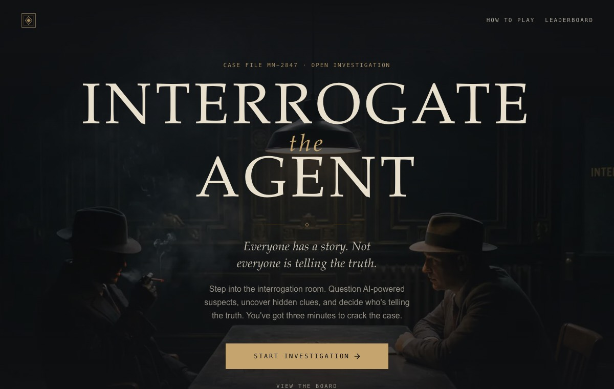

# Build a voice detective game with Agora Conversational AI

Alibai is a voice detective game. The player reads a fictional case file, then questions one live AI suspect out loud for three minutes. The suspect is an Agora Conversational AI agent with an Anam avatar, ARES speech-to-text, `gpt-4o-mini` and a MiniMax voice. When time is up the player calls guilty or innocent, cites evidence, and the server scores the interview out of 1,000.

Play it at [alibai-game.vercel.app](https://alibai-game.vercel.app). You need a Google account and a microphone.



This guide is for builders. It explains what the project shows on Agora, how to run it with your own accounts, how the pieces fit, and where the limits are. The stack is Next.js 16, React 19, TypeScript, Supabase (Postgres, Auth, Realtime) and Vercel.

## What this recipe demonstrates

- **A server-first agent start, in the quickstart order.** `POST /api/sessions/:id/connect` claims the run in Postgres, starts the agent through the `agora-agents` SDK, commits the agent ID, and only then returns the RTC and RTM tokens. The browser joins the channel after that response, so the agent always exists before the player arrives. This order is deliberate: nothing joins a channel the server has not already populated, and the clock cannot start on an agent that failed to come up.
- **Media readiness as the clock gate.** The browser waits for the first decoded audio frame *and* the first decoded avatar video frame, then calls `ready`. A successful start call never starts the clock on its own.
- **An avatar pipeline on Agora's managed providers.** ARES STT, `gpt-4o-mini`, MiniMax `speech_2_6_turbo` TTS at 24 kHz, and an Anam avatar publishing H.264 video, all configured on the server with one `Agent` builder chain.
- **Live captions over RTM.** `agora-rtm` plus `agora-agent-client-toolkit` render both sides of the conversation on a tape recorder. Captions are display only and never reach the server.
- **Server-side scoring from what the suspect actually said.** Every five seconds the server fetches the agent's history from Agora with server credentials, matches each reply against the case's scripted disclosure lines, and records facts in Postgres. The case truth, answer key and undiscovered evidence live in server-only tables; the browser gets allowlisted fields and can never award a point.

## Prerequisites

Accounts:

| Account | What you need |
| --- | --- |
| [Agora](https://console.agora.io) | A project with Conversational AI enabled. You need its App ID and App Certificate. The managed ARES, OpenAI and MiniMax providers need no extra keys of your own. |
| [Anam](https://anam.ai) | An API key. The avatar IDs the game uses are listed in [`lib/game/avatar-catalog.ts`](../../lib/game/avatar-catalog.ts); your key must have access to the actors you keep in that catalog. |
| [Supabase](https://supabase.com) | A hosted project, or the Supabase CLI with Docker for a local stack. You need the project URL, the publishable key and the secret key. |
| Google Cloud | An OAuth web client ID and secret, entered in Supabase's Google provider settings. Sign-in is Google-only. |

Tools: Node 22 or newer, [pnpm](https://pnpm.io) (`package.json` pins `pnpm@12.3.4`), the [Supabase CLI](https://supabase.com/docs/guides/local-development/cli/getting-started), and optionally the [Agora CLI](https://github.com/AgoraIO/cli) to write the Agora keys for you.

## Run it locally

### 1. Install

```sh
git clone https://github.com/AgoraIO-Community/alibai-game.git
cd alibai-game
pnpm install --frozen-lockfile
cp env.example .env.local
```

### 2. Create the database

The schema is in [`supabase/migrations/`](../../supabase/migrations) and the sixteen cases are in [`lib/scenarios/cases/`](../../lib/scenarios/cases). Pick one path.

**Local Supabase with Docker:**

```sh
supabase start
pnpm data:setup:local
```

`pnpm data:setup:local` runs `supabase db push --include-seed` against the local stack, which applies the migrations and publishes the cases. `supabase status` prints the local URL and keys for `.env.local`.

**Hosted Supabase project:**

```sh
supabase login
supabase link --project-ref <your-project-ref>
pnpm data:setup
```

[`scripts/data/README.md`](../../scripts/data/README.md) also covers setup through the SQL Editor without the CLI, and what to do on a project that already has data.

### 3. Fill in `.env.local`

[`env.example`](../../env.example) lists every variable. These seven are required:

| Variable | What it's for |
| --- | --- |
| `APP_ORIGIN` | The app's exact origin, such as `http://localhost:3000`. It drives the origin check on every POST and the OAuth redirect. |
| `NEXT_PUBLIC_SUPABASE_URL` | Supabase project URL |
| `NEXT_PUBLIC_SUPABASE_PUBLISHABLE_KEY` | Supabase publishable key |
| `SUPABASE_SECRET_KEY` | Supabase secret key, server only |
| `NEXT_PUBLIC_AGORA_APP_ID` | Agora App ID |
| `NEXT_AGORA_APP_CERTIFICATE` | Agora App Certificate, server only |
| `ANAM_API_KEY` | Anam API key, server only |

The Agora CLI can write the two Agora keys for you. `env.example` carries the command; replace `testing` with your own project name:

```sh
agora login
agora project env write .env.local --project <your-project> --template nextjs --append --json
```

[`scripts/agora-setup.mjs`](../../scripts/agora-setup.mjs) wraps that command, but it is hard-wired to a project named `testing`, so edit it or run the CLI directly. `--append` adds keys without touching the rest of the file; don't use `--overwrite` on a populated `.env.local`.

Leave `ENABLE_MANUAL_INTERVIEW=false`. The `SCENARIO_LLM_*` and `SCENARIO_REVIEW_LLM_*` variables are only for offline case generation and can stay blank.

### 4. Set up Google sign-in

Follow [`docs/google-auth.md`](../google-auth.md). In short: enable Google in Supabase Authentication > Providers with your Google client ID and secret, give Google the redirect URI `https://<your-project-ref>.supabase.co/auth/v1/callback`, and add `http://localhost:3000/auth/callback` to Supabase's Redirect URLs. For a local Docker stack, configure the provider in [`supabase/config.toml`](../../supabase/config.toml) instead.

### 5. Play

```sh
pnpm dev
```

Open `http://localhost:3000`, continue with Google at `/rules`, pass the microphone check, and take a case. Run `pnpm agents:cleanup:watch` in a second terminal so agents from closed tabs are stopped.

Useful checks that need no live services: `pnpm typecheck`, `pnpm lint`, `pnpm test` and `pnpm scenarios:validate`.

## Architecture

```text
Browser (Next.js app, React 19)
  components/game/production-session.tsx      the interrogation room
  lib/agora/use-suspect-voice.ts              RTC join, mic, media gate, token renewal
  lib/agora/live-transcript.ts                RTM captions (display only)
        │  /api/sessions/:id/{read,connect,ready,sync-facts,end,verdict}
        ▼
Next.js route handlers (Node runtime, Vercel pdx1)
  lib/server/voice.ts                         connect / ready / stop orchestration
  lib/agora/server-agent.ts                   Agent builder, tokens, history fetch
  lib/server/provider-facts.ts                transcript → verified facts
  lib/server/game.ts                          suspect prompt, projections
        │                         │
        ▼                         ▼
Supabase Postgres              Agora Conversational AI
  session_connect, session_ready,   ARES STT → gpt-4o-mini → MiniMax TTS
  session_action, agent_lifecycle   + Anam avatar (H.264 video)
  RLS on every table; game RPCs     RTC audio/video to the browser
  are service-role only             RTM captions to the browser
```

Fixed identities per session, from [`lib/agora/server-agent.ts`](../../lib/agora/server-agent.ts): channel `case-<sessionId>`, player RTC UID `1001`, agent UID `123456`, avatar UID `1002`, and RTM user ID `player-<sessionId>`. RTM allows one login per user ID across the whole project, so deriving it from the session keeps concurrent players from kicking each other. RTC and RTM tokens are separate and live for 300 seconds; the browser never receives a ConvoAI REST token, the App Certificate, the Anam key or the suspect's prompt.

### Key files

| File | What it does |
| --- | --- |
| [`lib/agora/server-agent.ts`](../../lib/agora/server-agent.ts) | Builds the `Agent` with `AresSTT`, `OpenAI` (`gpt-4o-mini`), a `MiniMaxTTS` subclass that adds `audio_setting.sample_rate: 24000`, and `AnamAvatar`. Also mints RTC/RTM tokens, stops agents, queries status and fetches history. |
| [`lib/server/voice.ts`](../../lib/server/voice.ts) | `connectVoice`, `readyVoice` and `stopVoice`: the server side of the connect order. |
| [`lib/server/provider-facts.ts`](../../lib/server/provider-facts.ts) | `syncProviderFacts`: fetches agent history and records verified disclosures. |
| [`lib/scenarios/provider-disclosures.ts`](../../lib/scenarios/provider-disclosures.ts) | The matcher: a scripted line must be asserted in its own sentence, not in a denial, question, quote or hypothetical. |
| [`lib/server/game.ts`](../../lib/server/game.ts) | `buildSuspectAgentContext` writes the suspect's system prompt from the immutable case; projections decide what the browser may see. |
| [`app/api/sessions/[id]/[action]/route.ts`](../../app/api/sessions/[id]/[action]/route.ts) | The session actions: `read`, `connect`, `ready`, `sync-facts`, `end`, `verdict`. |
| [`lib/agora/use-suspect-voice.ts`](../../lib/agora/use-suspect-voice.ts) | Browser media lifecycle with `agora-rtc-sdk-ng`. |
| [`lib/agora/live-transcript.ts`](../../lib/agora/live-transcript.ts) | Captions with `agora-rtm` and `agora-agent-client-toolkit`. |
| [`lib/game/lead-matching.ts`](../../lib/game/lead-matching.ts) | Marks a notebook lead as asked from the player's finished captions, in the browser only. |
| [`components/game/production-session.tsx`](../../components/game/production-session.tsx) | The room: polls `sync-facts` every 5 s while live, and refreshes on Supabase Realtime inserts. |
| [`supabase/migrations/20261105190000_connect_flow.sql`](../../supabase/migrations/20261105190000_connect_flow.sql) | `session_connect` and `session_ready`. |
| [`supabase/migrations/20261105170000_disclosure_and_scoring.sql`](../../supabase/migrations/20261105170000_disclosure_and_scoring.sql) | `session_action`: fact recording, verdicts and the score formula. |
| [`scripts/cleanup-agents.ts`](../../scripts/cleanup-agents.ts) | The cleanup worker. |
| [`docs/agora.md`](../agora.md) | The voice and avatar pipeline in more depth, including the map from the official Next.js quickstart to this code. |

## How a game runs

Session states are `created → preparing → active → ended → scored`, or `abandoned` if the clock never started.

1. **Assign.** `POST /api/sessions` runs the `assign_scenario` RPC, which picks a case the player hasn't played and freezes one Anam avatar and one MiniMax voice on the session. Guilt is fixed per case and never chosen at join time.
2. **Read.** The room loads from `GET .../read`, so the briefing shows without waiting on Agora.
3. **Connect, server first.** The browser requests the microphone, then calls `POST .../connect`. On the server, `session_connect` checks ownership, reads the session and claims the run in one call. Only the caller that wins the claim builds the prompt with `buildSuspectAgentContext`, calls `startSuspectAgent`, commits the returned agent ID through `agent_lifecycle`, and responds with the view plus `createPlayerRtcCredentials(sessionId)`. A second concurrent call gets `AGENT_START_PENDING` (409); a call against a running agent just gets fresh tokens, which is also how the browser renews them on `token-privilege-will-expire`. If the start fails, the server stops anything it started, marks the run `failed`, and the session is abandoned.
4. **Join.** Now the browser creates an RTC client (`mode: 'rtc'`, `codec: 'h264'`), registers `user-published` listeners *before* joining so it doesn't miss the already-running agent, joins with the server's channel, UID and token, publishes the mic, and subscribes only to the agent and avatar UIDs. Captions start beside the join without being awaited.
5. **Ready.** When both the audio track and the avatar video track fire `first-frame-decoded`, the suspect appears and the browser calls `POST .../ready`. The server confirms the agent is `RUNNING` with Agora, then `session_ready` stamps `started_at`. The three-minute clock is measured on the server; browser timers are corrected with `serverTime`. If no media arrives within 60 seconds the browser gives up, ends the session and offers a new case.
6. **Discover.** Every 5 seconds the room calls `POST .../sync-facts`. The server fetches the agent's history from Agora with a ConvoAI token, hashes each assistant reply, and runs `matchProviderDisclosures`. A matched fact is recorded through `session_action`, which unlocks evidence and follow-up leads; an insert on `session_updates` reaches the browser over Supabase Realtime and refreshes the notebook. The request carries no transcript, fact ID or score.
7. **End.** `POST .../end` runs a final sync, ends the session and stops the agent with the persisted agent ID. Unmounting the room sends a best-effort `end` with `keepalive`; the cleanup worker is the authority when a tab vanishes.
8. **Verdict.** `POST .../verdict` accepts one verdict and the cited evidence. SQL computes the score: 500 for the right verdict, up to 300 for pivotal evidence (only with the right verdict, and a wrong citation cancels a right one), up to 150 for facts found, and up to 50 for time left, with no time bonus if no fact was found.

### The suspect's prompt

`buildSuspectAgentContext` in [`lib/server/game.ts`](../../lib/server/game.ts) gives the model only the suspect's own side of the case: their timeline, what they know, the narrow deceptions they're allowed, and the public evidence. Each fact carries `disclosurePhrases`, lines the suspect would really say, and the prompt asks for one of them word for word when a fact is given up. Only the server-side matcher decides what was disclosed.

## Deploy

The production game runs on Vercel.

- [`vercel.json`](../../vercel.json) pins functions to `pdx1` so the route handlers sit next to the Supabase project in the same region. Pick the region that matches your Supabase project.
- Set the seven variables above for the Production environment, with `APP_ORIGIN` equal to your deployed origin. Preview deployments build without them but their APIs fail.
- Add `https://<your-origin>/auth/callback` to Supabase's Redirect URLs and set the Site URL to the deployed origin.
- Run the cleanup worker somewhere long-running: `pnpm agents:cleanup:watch` sweeps every minute, stopping agents whose interview has passed 180 seconds, releasing runs that never committed within five minutes, and ending the session. Agents also expire on their own after five minutes (`expiresIn` in `server-agent.ts`), so a missed sweep costs minutes, not hours. The worker needs a long-running host; Vercel's Hobby plan isn't suitable.
- Pushing to `main` deploys production.

## Troubleshooting

| Symptom | Cause and fix |
| --- | --- |
| `INVALID_ORIGIN` (403) on every POST | `APP_ORIGIN` doesn't match the page origin exactly, including scheme and port. |
| `AGENT_START_PENDING` (409) from `connect` | Another `connect` for this session holds the claim, usually a second tab. Let it finish and reconnect from the room; a start that never commits is released by the cleanup worker after five minutes. |
| `AGENT_NOT_READY` (409) from `ready` or `sync-facts` | The run has no committed agent ID, or Agora doesn't report it `RUNNING`. Reconnect from the room. |
| "The suspect's audio and avatar did not connect in time" | No decoded audio and video within 60 seconds. Check that Conversational AI is enabled on the Agora project, that `ANAM_API_KEY` can use the avatar in the catalog, and the browser console for `user-published` events. |
| Suspect is silent but video plays | Browser autoplay blocked audio. The room shows a resume control; tapping it replays the track from a user gesture. |
| Captions say unavailable | RTM login or the toolkit failed. Voice is unaffected; captions never block the media path. A `SAME_UID_LOGIN` failure means two clients logged in with the same session's RTM ID. |
| Google sends you to `localhost` in production | Supabase's Site URL or Redirect URLs are wrong. The app only forwards what Supabase returns. |
| `MEDIA_NOT_CONFIGURED` (503) | Something called the dev-only `start` action with `ENABLE_MANUAL_INTERVIEW` unset. Leave it `false` and use `connect`. |
| `POOL_EXHAUSTED` | The player has played every published case. Each case can be played once per player. |
| Reconnecting after a long drop fails | The agent's `idleTimeout` is 30 seconds. Finish the verdict with the evidence already recorded. |
| `pnpm build -- --webpack` fails | Use `pnpm build --webpack` without the `--` separator. |

## Known limits

- **Paraphrased facts aren't credited.** A fact counts only when the suspect uses one of its scripted `disclosurePhrases` in a plain sentence. Punctuation, contractions and a lead-in are fine, but a paraphrase earns nothing, so some clues can be missed. This is the biggest known weakness and the price of scoring the model's output without trusting it.
- **A guilty suspect's prompt contains what they did.** The model is told to deny the crime, but a determined player could try to coax the truth out. Innocent suspects are never told who did it.
- **History is model memory, not playback proof.** Agora's managed history has no per-turn timestamps, keeps a 30-message window, and shows what was generated rather than what the player heard. Replies first seen after the 195-second turn window are not credited.
- **Ending at once earns most of the time bonus**, as long as at least one fact was found.
- **Access tokens are verified locally**, so a token revoked by logout works until it expires (one hour).
- Each player can play each case once, and the cleanup worker needs its own host.

## License

MIT. See [`LICENSE`](../../LICENSE). Copyright (c) 2026 digitallysavvy.
